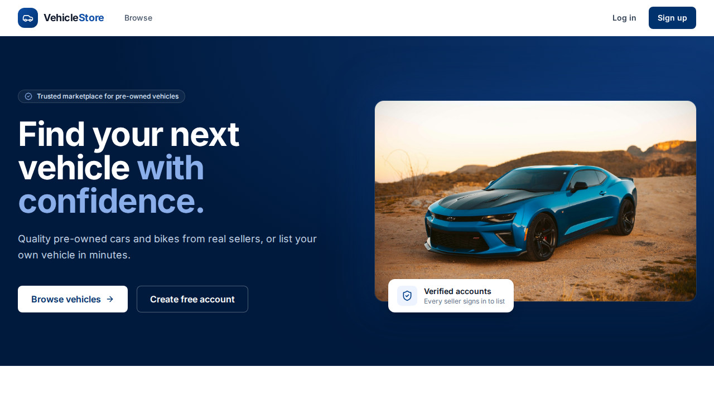
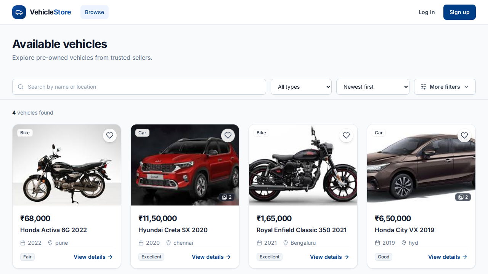
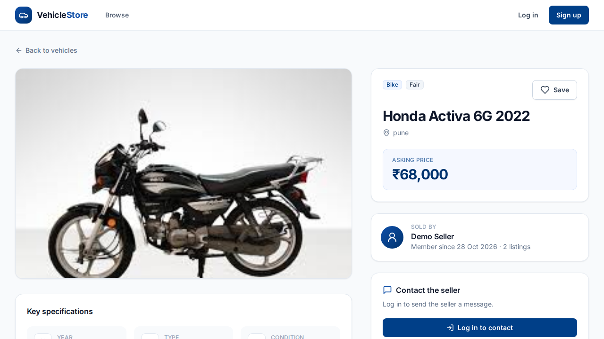
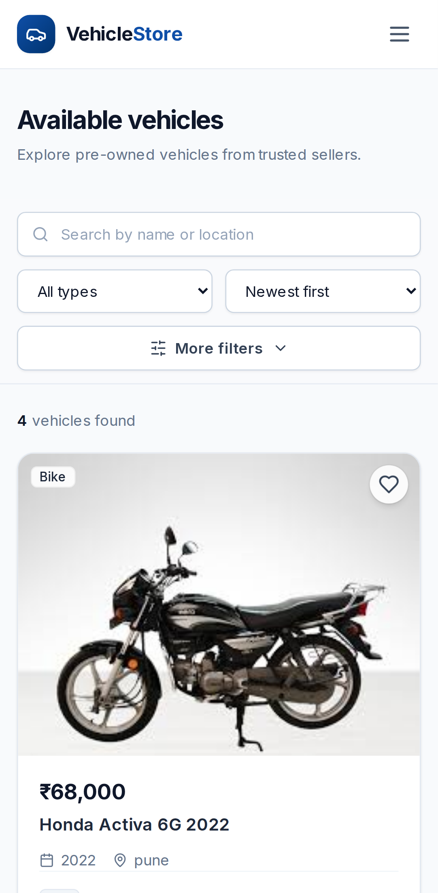

# VehicleStore — second-hand vehicle marketplace

[](https://github.com/Devisri4/vehicle-store/actions/workflows/ci.yml)
[](https://github.com/Devisri4/vehicle-store/actions/workflows/e2e.yml)

A full-stack marketplace where buyers browse and save used cars and bikes, chat with sellers, and sellers
manage their listings — with an admin panel on top. Built with **React, Tailwind CSS and Supabase
(PostgreSQL)**, deployed on **Vercel**, and covered by **Playwright end-to-end tests** in CI.

**🔗 Live demo: [vehicle-store-nine.vercel.app](https://vehicle-store-nine.vercel.app)** — no sign-up needed:
open **Log in** and click **Demo buyer** or **Demo seller**.



<table>
  <tr>
    <td width="40%"></td>
    <td width="40%"></td>
    <td width="20%" rowspan="2"></td>
  </tr>
  <tr>
    <td align="center">Browse with search, filters and sorting</td>
    <td align="center">Vehicle page with seller card</td>
  </tr>
</table>

<sub>Screenshots are captured automatically by the Playwright test run.</sub>

---

## Features

**Anyone**
- Browse listings without an account; search by name or location, filter by type, price range and year,
  sort by price, year or date — filters live in the URL, so a search can be shared
- Vehicle pages with a photo gallery (up to 4 photos), key specs and a public seller card

**Buyers**
- Contact a seller from any listing and continue the conversation in an in-app thread
- Save vehicles with ♥ and find them under **Saved**; see sent messages under **My Enquiries**

**Sellers**
- Post, edit and delete listings with multiple photos (large photos are resized in the browser before upload)
- Mark a vehicle as sold or relist it; reply to buyers from **Messages**

**Admins**
- Dashboard with user, seller, listing and message counts
- Delete any listing or user, and switch users between buyer and seller

**Everyone with an account**
- Account settings (name, password), forgot/reset password by email

**Polish:** responsive design, loading skeletons, empty states, styled confirm dialogs and toasts,
error boundary, per-page titles, link-preview image, and public demo accounts for reviewers.

## Tech stack

| Layer | Technology |
| --- | --- |
| Frontend | React 18, React Router 6, Vite 6, Tailwind CSS 3, lucide-react icons |
| Backend | Supabase — PostgreSQL, Auth, Storage, Row Level Security, SQL functions |
| Server code | Vercel serverless functions (`api/`) |
| Hosting | Vercel (deploys on every push to `main`) |
| Testing | Playwright end-to-end tests, ESLint |
| CI/CD | GitHub Actions: lint + build, E2E tests, database keep-alive |

## Security design

All access rules are enforced **in the database**, not just hidden in the UI:

- **Row Level Security on every table.** Users read and change only their own rows; sellers edit only their
  own vehicles; messages are visible only to the buyer, the seller of that vehicle and admins.
- **Column-level grants.** Users can never write `role`, `seller_id` or `sender_id` — the database fills
  them in from the logged-in user, so nobody can post as someone else or make themselves admin.
- **Roles from the database.** Sign-up only accepts *buyer* or *seller*; admin is assigned manually.
- **Narrow public data.** Profiles are private; a `security definer` function exposes only a seller's
  name, join date and listing count.
- **Secret key stays on the server.** Deleting a user needs Supabase's secret key, so it runs in a Vercel
  function (`api/delete-user.js`) that first verifies the caller is an admin. The browser only ever has the
  public key.
- **Storage rules.** Sellers can upload only into a folder named after their user id (max 4 photos, 5 MB,
  JPEG/PNG/WebP).

## Testing

19 Playwright tests run in real Chrome against the live site after every deployment (desktop + a
phone-sized screen). They are read-only — they never create or delete data.

- **Public:** homepage, browsing without login, search, sorting, filters, vehicle page, 404 pages, health check
- **Auth and access control:** demo logins, role-based navigation, buyers blocked from seller and admin pages,
  private pages require login, wrong-password error, logout
- **Responsive:** mobile menu, no sideways scrolling, single-column cards

The workflow waits until Vercel serves the pushed commit (reported by `/api/health`), then runs the suite.
Every run uploads **videos, screenshots and step-by-step traces** as the `test-recordings` artifact — open a
trace at [trace.playwright.dev](https://trace.playwright.dev).

## Project structure

```
api/                    Vercel serverless functions (admin user deletion, health check)
e2e/                    Playwright end-to-end tests
src/
  components/           Navbar, cards, gallery, forms, shared UI kit (ui.jsx)
  context/              Auth, saved vehicles, toasts and confirm dialogs
  lib/                  Supabase client, vehicle and image helpers
  pages/                One file per route
supabase/migrations/    Database schema, policies and functions (run in order)
.github/workflows/      CI, E2E tests, database keep-alive
```

## Run it yourself

1. **Database:** create a Supabase project and run the files in `supabase/migrations/` in order in the
   SQL Editor.
2. **Environment:** copy `.env.example` to `.env` and fill in your project URL and publishable key.
   For admin user deletion on Vercel, also set `SUPABASE_SECRET_KEY` (server-only, never prefixed `VITE_`).
3. **Start:** `npm install` then `npm run dev`.
4. **Checks:** `npm run lint`, `npm run build`, `npm run test:e2e`
   (set `E2E_BASE_URL=http://localhost:5173` to test your local copy).
5. **Admin account:** sign up, then run
   `update public.profiles set role = 'admin' where email = 'you@example.com';`

## Background

This project started as an HTML/Express/MySQL app and was rebuilt on React, Supabase and Vercel.
The original version is preserved separately.

## Image credits

Homepage, login and link-preview photos are from [Unsplash](https://unsplash.com)
(photo IDs `1552519507-da3b142c6e3d` and `1503376780353-7e6692767b70`), used under the
[Unsplash License](https://unsplash.com/license).
